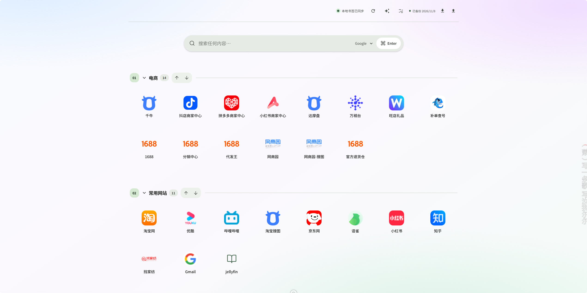

# 浏览器首页

一个运行在自己电脑上的书签导航页。把常用网址按分类集中在浏览器首页，支持搜索、拖动排序、一键收藏、本地数据保存和备份恢复。默认只监听本机地址，不需要把书签数据放到公共云服务。

<p align="center">
  
</p>

## 项目特点

- **一页管理常用网站**：按分类展示书签，可新增、重命名、排序和折叠分类。
- **搜索与快速访问**：输入关键词后跳转到当前搜索引擎；可在设置中添加或调整搜索引擎。
- **浏览器扩展一键收藏**：支持 Chrome 和 Edge，从工具栏或网页右键菜单把当前页面保存到本地首页。
- **书签个性化**：编辑名称、网址和描述，刷新网站图标或上传自定义图标，调整图标大小。
- **本地数据**：书签和首页偏好使用 SQLite 保存；可选连接 Obsidian Markdown 笔记。
- **备份与恢复**：支持手动、每周自动备份和导入 ZIP；导入前会先保存当前数据回滚包。
- **隐私分组**：可为分组设置密码，解锁后临时查看内容。
- **明暗外观**：支持浅色和深色主题，并适配不同屏幕宽度。

## 项目结构

| 路径 | 用途 |
| --- | --- |
| `backend/` | FastAPI 首页接口、SQLite 书签与偏好存储 |
| `frontend/` | React、TypeScript 和 Vite 前端 |
| `backup_service/` | 本机备份、归档校验和恢复服务 |
| `browser-extension/` | Chrome / Edge Manifest V3 一键收藏扩展 |
| `docs/deployment.md` | 部署约定和数据目录说明 |
| `docs/spec.md` | 当前运行规格和安全边界 |
| `docs/assets/` | 项目截图和联系方式图片 |

## 安装和运行

### Windows 环境要求

- Windows 10 或更新版本。
- Python 3.12 或更新版本。
- Node.js 18 或更新版本，以及 Corepack 提供的 pnpm。
- Git。

本 GitHub 仓库目前提供应用源码，不包含工作区专用的 Windows 服务安装脚本。以下方式从源码在本机运行应用；如果希望开机自动启动，可以部署成功后再让 AI 按你的 Windows 环境配置启动任务。

### 1. 下载项目

在 PowerShell 中运行：

```powershell
git clone https://github.com/zfun3018/Browser_home.git
Set-Location .\Browser_home
```

如果你已下载 ZIP，则解压后在 PowerShell 中进入包含 `backend`、`frontend` 和 `backup_service` 的项目目录。

### 2. 安装依赖并构建前端

```powershell
py -3.12 -m venv .venv
& .\.venv\Scripts\python.exe -m pip install --upgrade pip
& .\.venv\Scripts\python.exe -m pip install -r backend\requirements.txt -r backup_service\requirements.txt
corepack enable
pnpm --dir frontend install --frozen-lockfile
pnpm --dir frontend run build
```

`pnpm run build` 成功后，前端产物位于 `frontend\dist`。

### 3. 准备本地数据和捕获令牌

在项目根目录 PowerShell 中执行。示例将数据、笔记、备份和令牌保存在项目目录旁边的本地文件夹中；你可以按需要修改 `$Root`。已有数据时请使用原有目录，不要用空目录覆盖。

```powershell
$Root = (Get-Location).Path
$DataDir = Join-Path $Root 'homepage-data'
$NotePath = Join-Path $DataDir '浏览器首页笔记.md'
$NativeDir = Join-Path $Root 'native'
$SecretDir = Join-Path $Root 'homepage-secrets'

New-Item -ItemType Directory -Force -Path $DataDir, $NativeDir, $SecretDir, `
  (Join-Path $Root 'backups'), (Join-Path $Root 'homepage-backup-staging') | Out-Null
if (-not (Test-Path $NotePath)) { New-Item -ItemType File -Path $NotePath | Out-Null }

$NativeConfig = Join-Path $NativeDir 'native-config.json'
if (-not (Test-Path $NativeConfig)) {
  [ordered]@{
    formatVersion = 1
    backend = 'sqlite'
    homepageHost = '127.0.0.1'
    homepagePort = 3011
    backupHost = '127.0.0.1'
    backupPort = 8010
    homepageDataDir = $DataDir
    obsidianNotePath = $NotePath
  } | ConvertTo-Json | Set-Content -Encoding UTF8 $NativeConfig
}

$TokenPath = Join-Path $SecretDir 'capture_token.txt'
if (-not (Test-Path $TokenPath)) {
  & .\.venv\Scripts\python.exe -c "import secrets; print(secrets.token_urlsafe(32))" |
    Set-Content -Encoding ascii $TokenPath
}
```

令牌用于浏览器扩展向本机服务提交收藏。不要把它贴到公开 issue、聊天记录或代码仓库中。

### 4. 启动首页和备份服务

需要两个 PowerShell 窗口。分别在每个窗口中进入项目根目录，并设置对应环境变量。

**窗口 A：启动首页服务**

```powershell
$Root = (Get-Location).Path
$env:HOMEPAGE_DATA_DIR = Join-Path $Root 'homepage-data'
$env:HOMEPAGE_STATIC_DIR = Join-Path $Root 'frontend\dist'
$env:BOOKMARK_DB_PATH = Join-Path $Root 'homepage-data\bookmarks.db'
$env:OBSIDIAN_NOTE_PATH = Join-Path $Root 'homepage-data\浏览器首页笔记.md'
$env:CAPTURE_TOKEN_FILE = Join-Path $Root 'homepage-secrets\capture_token.txt'
$env:BACKUP_SERVICE_URL = 'http://127.0.0.1:8010'
$env:PYTHONPATH = $Root
& .\.venv\Scripts\python.exe -m uvicorn backend.app.main:app --host 127.0.0.1 --port 3011
```

**窗口 B：启动备份服务**

```powershell
$Root = (Get-Location).Path
$env:NATIVE_PROJECT_ROOT = $Root
$env:HOMEPAGE_DATA_DIR = Join-Path $Root 'homepage-data'
$env:OBSIDIAN_NOTE_PATH = Join-Path $Root 'homepage-data\浏览器首页笔记.md'
$env:NATIVE_CONFIG_PATH = Join-Path $Root 'native\native-config.json'
$env:BACKUP_STAGING_DIR = Join-Path $Root 'homepage-backup-staging'
$env:BACKUP_OUTPUT_DIR = Join-Path $Root 'backups'
$env:PYTHONPATH = $Root
& .\.venv\Scripts\python.exe -m uvicorn backup_service.app:app --host 127.0.0.1 --port 8010
```

两个窗口保持运行，在浏览器打开 <http://127.0.0.1:3011>。健康检查地址分别为 `http://127.0.0.1:3011/health` 和 `http://127.0.0.1:8010/internal/health`。停止服务时，在对应窗口按 `Ctrl+C`。

> 备份归档包含首页数据库、Obsidian 笔记和本机部署配置。备份 ZIP 可能包含个人信息，请妥善保管，不要上传到公开网盘或仓库。

## 配置说明

### 常用环境变量

路径可使用绝对路径，Windows 示例中的反斜线由 PowerShell 处理。

| 变量 | 默认用途 |
| --- | --- |
| `HOMEPAGE_DATA_DIR` | SQLite、网站图标和冲突副本目录 |
| `BOOKMARK_DB_PATH` | 书签数据库，默认在数据目录下的 `bookmarks.db` |
| `HOMEPAGE_STATIC_DIR` | 前端构建目录；设置后由 FastAPI 同源提供页面 |
| `OBSIDIAN_NOTE_PATH` | 要读写的 Obsidian Markdown 文件 |
| `CAPTURE_TOKEN_FILE` | 浏览器扩展捕获令牌文件 |
| `BACKUP_SERVICE_URL` | 首页访问本机备份服务的地址，默认 `http://127.0.0.1:8010` |
| `NATIVE_PROJECT_ROOT` | 备份服务使用的本机项目根目录 |
| `NATIVE_CONFIG_PATH` | 备份中收录的本机配置 JSON |
| `BACKUP_STAGING_DIR` | 备份和恢复任务的临时目录 |
| `BACKUP_OUTPUT_DIR` | 备份 ZIP 输出目录 |
| `AUTO_BACKUP_ENABLED` | 是否启用自动备份，默认启用；设为 `false` 可关闭 |
| `AUTO_BACKUP_INTERVAL_SECONDS` | 自动备份间隔秒数，默认 604800（7 天） |

首次运行时，若不配置 `CAPTURE_TOKEN_FILE`，首页浏览与手动新增书签仍可使用，但扩展的一键收藏无法通过令牌校验。备份服务创建备份时需要能读取数据目录、笔记文件和配置 JSON。

### 首页内设置

点击页面右上角设置按钮，可以新增、重命名、删除和排序分类，设置分类密码，切换深色外观，并管理搜索引擎。搜索引擎网址模板需包含 `{query}`，例如：

```text
https://www.google.com/search?q={query}
```

右键点击书签可编辑标题、网址、描述、图标和图标大小，也可删除书签。拖动书签或分类可调整顺序。

### 自定义浏览器首页

服务启动后，在 Chrome 或 Edge 的“设置 → 启动时”或“外观 → 显示主页按钮”中填写：

```text
http://127.0.0.1:3011
```

也可将此地址加入书签栏，或在浏览器的新标签页扩展设置中选择打开本地页面（不同浏览器支持方式可能不同）。

## 浏览器扩展和使用教程

扩展源码位于 `browser-extension/`，适用于支持 Manifest V3 的 Chrome 和 Edge。

1. 打开 `chrome://extensions` 或 `edge://extensions`。
2. 启用“开发者模式”，点击“加载已解压的扩展程序”，选择项目中的 `browser-extension` 文件夹。
3. 打开扩展的“详细信息 → 扩展程序选项”。
4. 首页地址填写 `http://127.0.0.1:3011`。
5. 从本机 `homepage-secrets/capture_token.txt` 复制令牌到扩展设置并保存；令牌仅应留在本机。
6. 点击扩展图标，选择分类后收藏当前网页；勾选记住分类后可作为默认分类。
7. 也可以在网页上点右键，选择“收藏到浏览器首页”快速保存。
8. 回到首页即可找到新书签；可拖动它调整位置，或右键修改名称、描述和图标。

更多扩展说明见 [`browser-extension/README.md`](browser-extension/README.md)。

## AI 辅助一键部署教程

项目没有内置 AI 功能，也不会把书签发给 AI。AI 在这里是部署助手：你可以在支持读取本地文件和运行终端命令的编程助手中打开项目，让它检查环境、安装依赖、构建前端、准备本机配置并启动服务。常见工具包括 Codex、Cursor、Claude Code 或其他带终端能力的本地编程助手；具体能力取决于工具及其权限设置。

### 部署前准备

1. 将项目下载或克隆到你有写入权限的本机目录。
2. 安装 Git、Python 3.12+、Node.js 18+。
3. 在该项目目录中打开你的 AI 编程助手，并允许它读取项目文件、在项目目录中运行命令。
4. 如需把笔记同步到 Obsidian，先确定要使用的 Markdown 文件路径；没有 Obsidian 时，可使用项目本地的 `homepage-data/浏览器首页笔记.md`。
5. 首次部署允许 AI 下载 Python 和前端依赖。不要把本机令牌、密码、私人笔记内容或备份 ZIP 上传到 AI 对话。

### 可直接复制给 AI 的部署提示词

```text
请在当前 Windows 电脑上部署这个仓库中的“浏览器首页”项目。先阅读 README.md、docs/deployment.md、docs/spec.md 和相关配置，再检查电脑是否安装 Python 3.12+、Node.js 18+、Corepack/pnpm。

请按仓库当前代码实现来部署：安装 backend 和 backup_service 的 Python requirements；安装 frontend 依赖并构建前端；准备本机 SQLite 数据目录、备份目录、临时目录、一个可用的 Obsidian Markdown 笔记路径和 native/native-config.json；生成本机随机 capture token 文件；然后分别在 127.0.0.1:3011 启动首页服务、在 127.0.0.1:8010 启动备份服务，并验证两个 health 地址及首页能打开。

安全和数据要求：
- 先检查目标目录是否已有数据；不要覆盖、删除、迁移或重置已有数据库、笔记、配置或备份。发现已有数据或路径冲突时，先告诉我并等待确认。
- 不要把 token、密码、私人笔记或备份内容显示在聊天、终端日志或仓库中，也不要提交任何本机数据和密钥。
- 服务只绑定 127.0.0.1，不要开放到局域网或公网。
- 不要擅自安装 Windows 服务、设置开机启动、修改系统策略或执行管理员操作；如确实需要，先说明具体变更并询问我。
- 依赖安装和构建完成后，给我本机访问地址、两个服务的启动/停止方法、扩展配置步骤和备份位置。若某一步失败，停止并说明原因，不要通过删除数据来绕过问题。

请先给出将要执行的步骤和发现的现有数据情况，再开始安装；每一步完成后报告结果。
```

### 部署后第一次使用

1. 确认 `http://127.0.0.1:3011` 可以打开，右上角显示本地状态正常。
2. 在设置中整理分类，并选择你常用的搜索引擎。
3. 按“浏览器扩展和使用教程”安装扩展并在本地配置令牌。
4. 从常用网页使用扩展收藏书签；拖动书签和分类，调整成自己的布局。
5. 点击顶部备份按钮创建第一次备份，确认 `backups` 目录中生成 ZIP。
6. 如果需要开机启动，再让 AI 阅读 `docs/deployment.md` 并为你的电脑设计启动方式。确认它说明了具体会新增什么 Windows 服务或任务后，再决定是否让它执行。

### 日常使用

- **搜索网页**：在首页搜索框输入关键词，按 Enter；用下拉菜单切换搜索引擎。
- **打开书签**：点击图标或标题。
- **新收藏**：使用扩展工具栏按钮或网页右键菜单。
- **整理页面**：拖动书签或分类排序；通过设置管理分组和显示选项。
- **备份数据**：点击首页顶部的备份按钮。备份服务默认每周检查并在需要时生成备份。
- **恢复数据**：点击导入按钮选择受支持的 ZIP。系统会校验文件，并在替换前先生成当前数据的回滚包；仔细确认后再提交导入。
- **停止服务**：在启动服务的两个终端分别按 `Ctrl+C`。

## 开发

```powershell
# 后端测试
..\.venv\Scripts\python.exe -m pytest backend\tests -q

# 前端测试和生产构建
Set-Location frontend
pnpm test --run
pnpm run build
```

开发时 Vite 默认监听 `0.0.0.0` 以便本地访问；日常本机部署时应按上面的方式让应用服务只监听 `127.0.0.1`。

## 隐私与安全

- 首页和备份服务默认只监听回环地址 `127.0.0.1`，备份服务不应暴露到公网。
- 书签和首页设置保存在本机 SQLite 文件中；网站图标缓存在数据目录。
- 收藏扩展令牌保存在本机令牌文件和浏览器扩展本地存储中。不要将其提交到 GitHub 或粘贴给 AI。
- 分组密码用于首页显示保护，不应替代系统账户安全或加密磁盘。
- 备份 ZIP 包含书签数据库、首页设置、笔记和部署配置；像保护密码文件一样保护它。
- AI 部署只需要检查配置路径和服务状态。排查时可分享错误信息，但先删除令牌、密码、网址隐私信息和笔记正文。

## 联系方式

欢迎通过 GitHub Issues 反馈问题或建议。需要交流时可扫码添加微信：

<p align="center">
  
</p>

## 许可

如需复用或分发本项目，请先查看仓库中的许可证文件；当前仓库未提供许可证时，默认不代表授予额外的开源许可。
